# WinAppGuard

**See what is online. Block it in two clicks.**

**Open-source firewall** · built on WFP · **source available for audit and self-build**

[简体中文](README.md) · English

> Source and license: [github.com/lovercyh/winappguard](https://github.com/lovercyh/winappguard) (GPL-2.0)

WinAppGuard is a Windows firewall built on WFP. Instead of making you browse a program list, it shows the
**TCP connections that are online right now** — start from “which program is online”, end at “blocked”.

> **Current release: 5.6**
>
> - Install/repair adds the install folder to the system PATH, so a new terminal can run `WinAppGuard` directly.
> - Anti-network attack: Suricata 8.0.7 + ET Open, alerts only; you choose whether to apply a temporary WFP block.
>   Supports rule categories, one capture adapter and read/unread state.
> - Remote-IP ownership tooltips are available on the Connections, Anti-network attack and Records pages.
> - Auto-refresh can be switched off on the Connections, Records, DNS and Anti-network attack pages; the tables then
>   stop rebuilding on a timer and no longer jump back to the top.
> - Flow IDS and protection: port scans, LAN ARP/DHCP, DNS security, IPv6 neighbour security, config integrity.
> - CLI: read-only queries, JSON, rule operations, network detection and diagnostics. See [`docs/5.3-CLI.md`](docs/5.3-CLI.md).
> - **No automatic blocking, no new kernel driver, no automatic rule updates, no telemetry**; HTTPS payload is not visible.
>   Npcap 1.80+ is required.
>
> Full history and boundaries: [CHANGELOG](CHANGELOG.md), [`docs/安全说明.md`](docs/安全说明.md).

[](LICENSE)
[](#requirements)
[](https://github.com/lovercyh/winappguard/releases/latest)

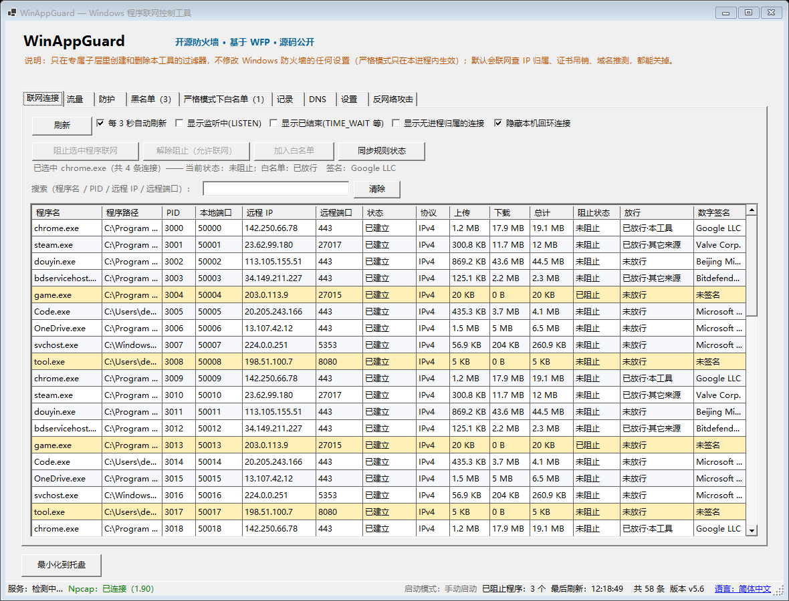

## What it does

- **Current connections**: program, full path, PID, local/remote address and port, state, protocol and signature;
  search and sort.
- **IP ownership tooltip**: hover a remote IP on the Connections, Anti-network attack or Records page to see country/region,
  AS and prefix; can be disabled in Settings.
- **Block / allow programs**: permanent, 30 minutes, 2 hours or until next restart; timed blocks expire automatically.
- **Strict mode (off by default)**: only whitelisted programs can connect. It is a session-level restriction in the
  service; exiting or a service crash removes it automatically. Windows Firewall is not changed. Also offers a
  30-minute / 2-hour timed lockdown.
- **Traffic page**: per-program inbound/outbound/down/up with a live 5-minute chart. Npcap counts packet headers only,
  not payload.
- **DNS page**: latest domains, PID, program and result; no URLs or response contents are stored.
- **Anti-network attack**: ET Open alerts, with categories for malware / exploit / DNS / TLS-JA3 / coinminer / phishing /
  web_client / other (phishing is off by default). After a match you can apply a temporary manual block. Alerts only;
  never automatic blocking.
- **Flow IDS and protection**: periodic beaconing, port/host scans, lateral movement and DNS anomalies; plus port scans,
  ARP/DHCP, DNS security, IPv6 neighbour security, name resolution and config integrity.
- **Records and rules**: who connected to whom, whether it was blocked, and which rule matched; IP blocking, rule groups
  and import/export.
- **CLI**: status, rules, network detection and diagnostics, with `--json`; available from a new terminal after install.

## What it does **not** do

- ❌ It does **not** forward, inspect or modify traffic, and does **not** do DPI / HTTPS decryption. Packet matching and
  blocking happen in the Windows kernel WFP.
- ❌ It does **not** change any Windows Firewall setting and does **not** touch filters created by other software;
  it only manages objects in its own WFP sublayer.
- ❌ It does **not** block automatically: IDS and anti-network attack only alert; blocking is always user-initiated.
- ❌ It does **not** store packets or payloads: traffic counts read IP/TCP/UDP headers only; DNS stores domains, not URLs.
- ❌ Anti-port-scan reads inbound TCP SYN headers only; DNS security only sees IPv4 UDP 53; IPv6 neighbour detection
  alerts by default and NDP is not blocked.
- ❌ It does **not** block critical system processes (`lsass.exe`, `svchost.exe`, itself, …).
- ⚠️ It **does use the network** for three explicit purposes; no telemetry, statistics or update checks. See below.

## Network and privacy

There are exactly three network uses, **all enabled by default and all switchable in the UI**:

| Purpose | What is sent | Destination | Where to turn it off |
|---|---|---|---|
| IP ownership lookup | remote IP only | `whois.cymru.com:43` | Settings → Data & privacy |
| Certificate revocation | CRL / OCSP query | the certificate's CA | Settings → Data & privacy |
| Domain guess | names already in the system DNS cache | local DNS server | Records page switch |

With all three off, the program generates **no network traffic**. The IP lookup never sends process names, paths, PIDs or
ports; LAN, loopback and link-local addresses are filtered before sending. A one-time notice is shown on first run.

## Command line

Read-only queries need no administrator rights; writing rules, importing and blocking do. See
[`docs/5.3-CLI.md`](docs/5.3-CLI.md) for the full list.

```powershell
WinAppGuard --status --json                    # service / rules / detection status
WinAppGuard --block "C:\Tools\a.exe"           # permanent block
WinAppGuard --block "C:\Tools\a.exe" --minutes 30
WinAppGuard --unblock "C:\Tools\a.exe"         # remove one program's block
WinAppGuard --network-status --json            # anti-network attack status
WinAppGuard --network-alerts --limit 20 --json
WinAppGuard --doctor --json                    # read-only diagnostics
```

- `--json` uses stable English keys for scripts. Exit codes: `0` success / `1` bad arguments or not confirmed / `2`
  failed / `3` not elevated / `4` not found.
- Batch or irreversible actions require `--yes`; preview with `--dry-run`. GUI actions still ask every time.
- Since 5.4, install/repair adds the install folder to the system PATH. Terminals that were already open must be reopened.

## Screenshots

| Anti-network attack | Protection (port scan) |
|---|---|
| 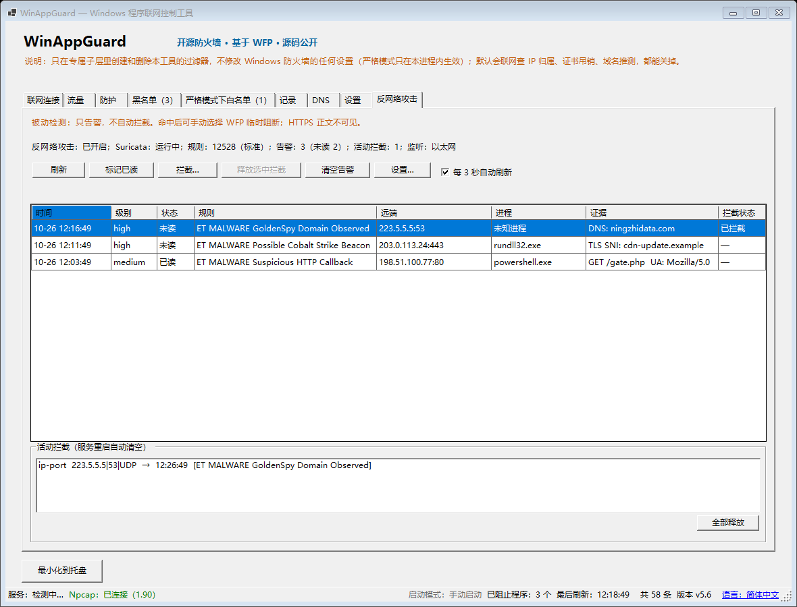 | 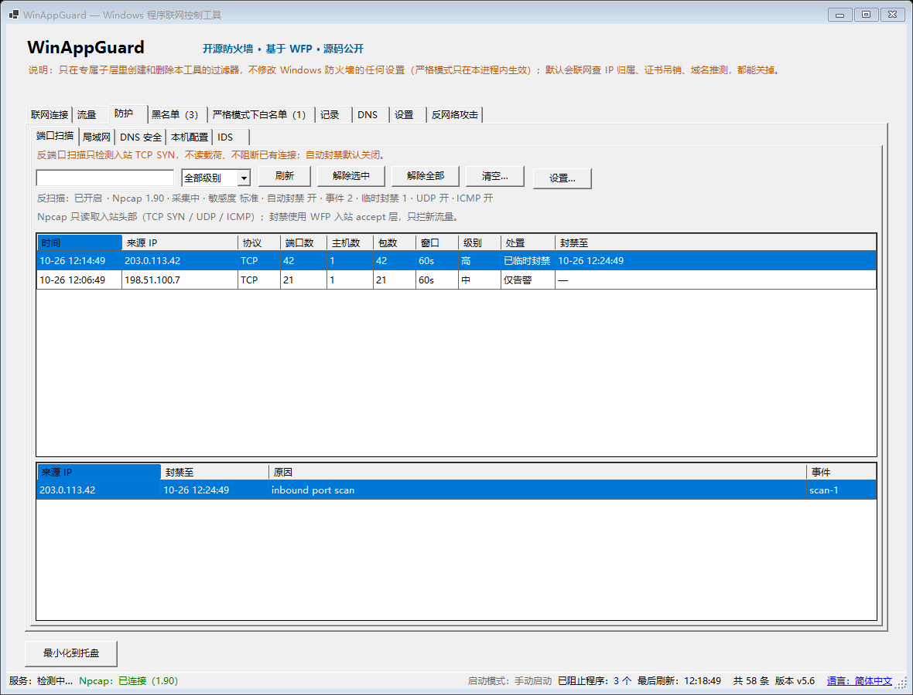 |
| **IDS** | **Traffic** |
| 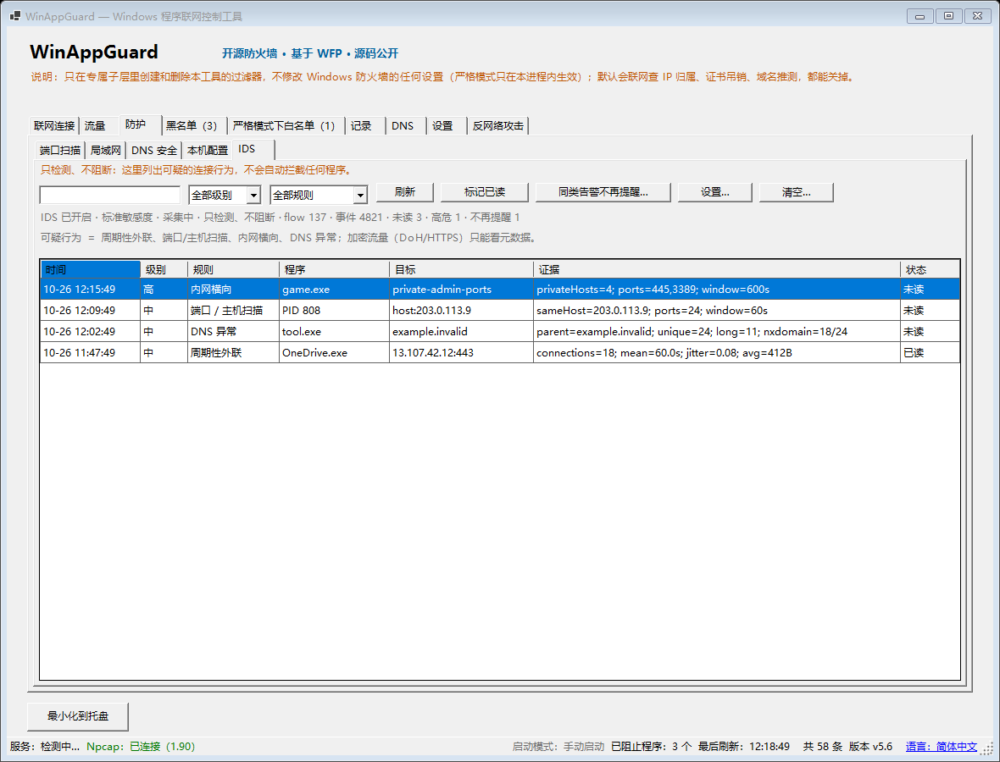 | 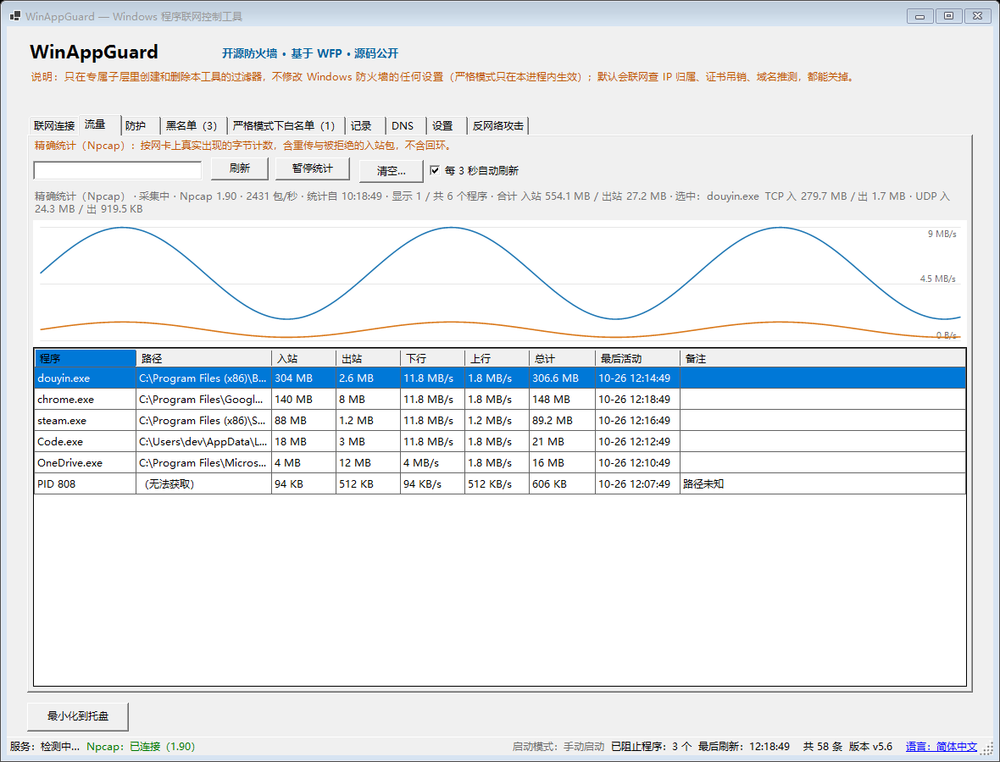 |
| **DNS** | **LAN** |
| 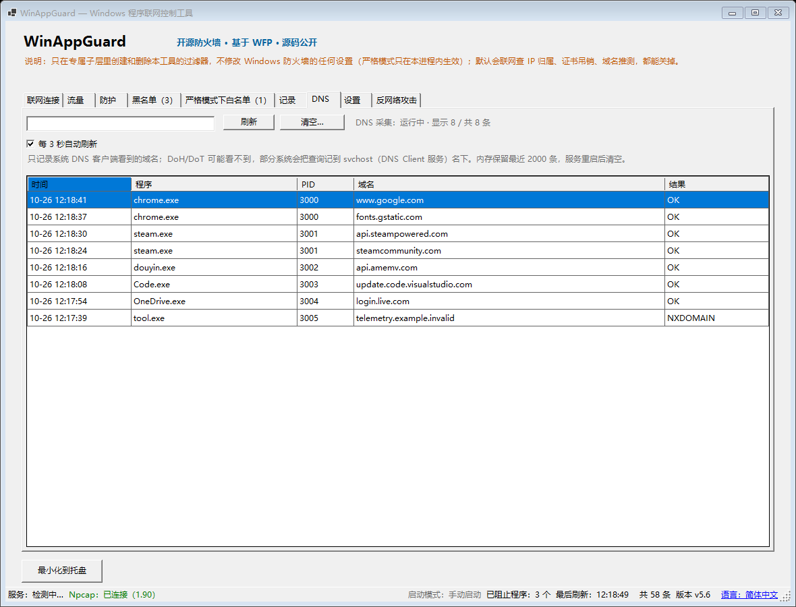 | 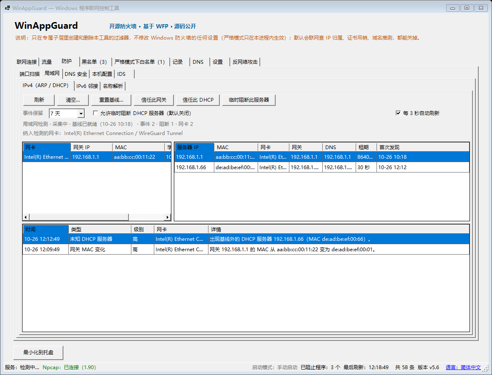 |
| **Blocklist** | **Strict-mode whitelist** |
| 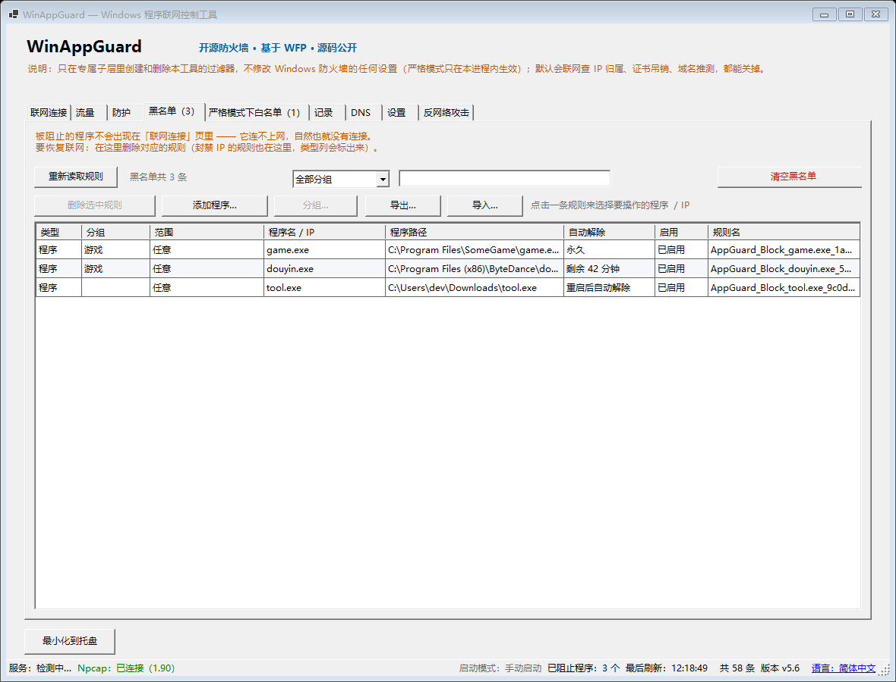 | 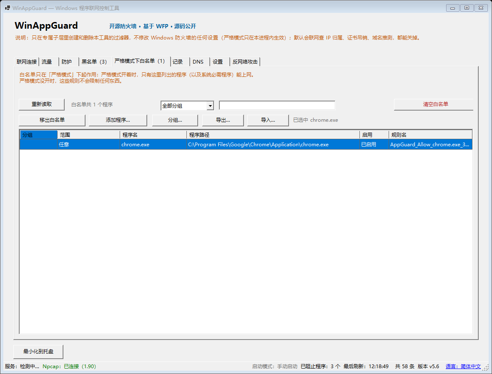 |
| **Settings** | **Anti-network attack settings** |
| 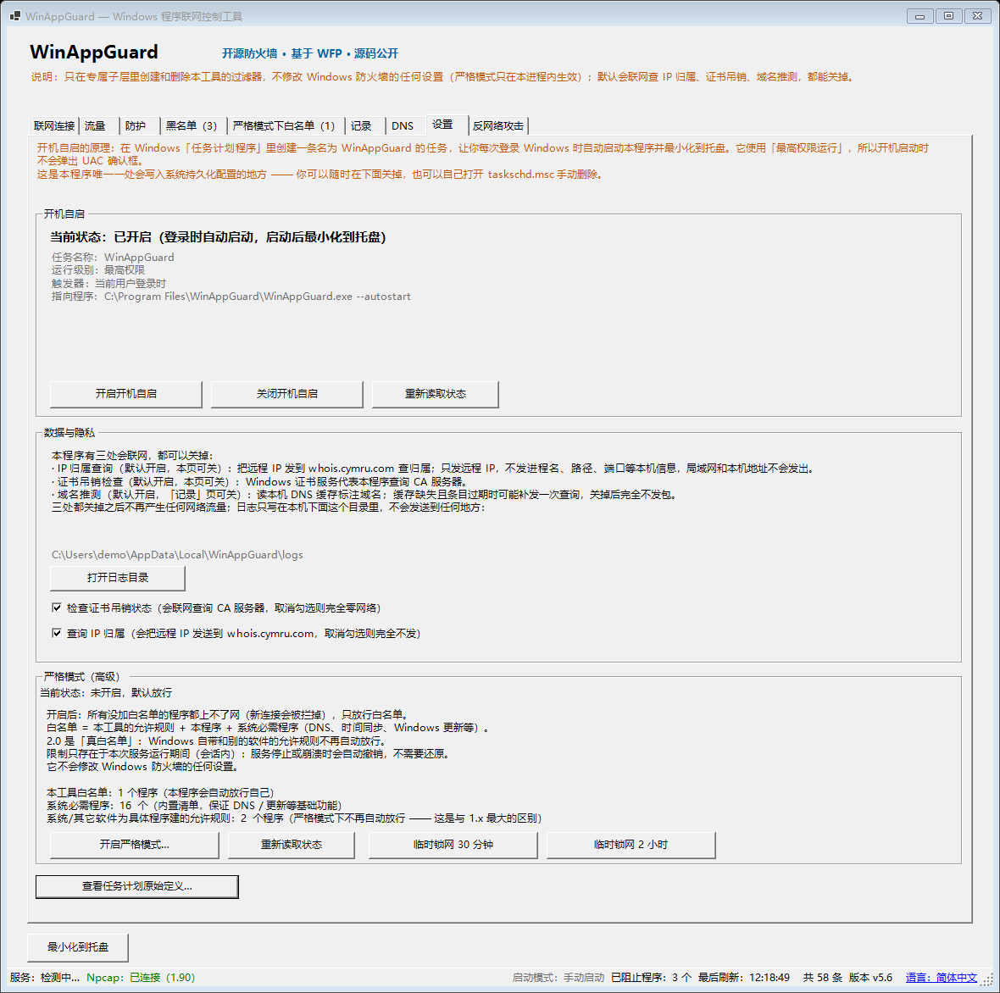 | 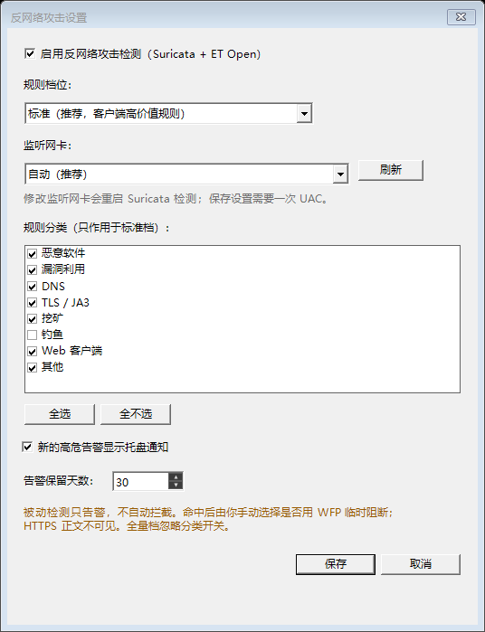 |

Every state-changing action goes through a confirmation dialog that names the program, full path, scope and the rule
about to be created or deleted.

## Install / uninstall

Download from [Releases](https://github.com/lovercyh/winappguard/releases):

| File | Purpose |
|---|---|
| **`WinAppGuardSetup.exe`** | Install / repair (UI and service are bundled inside) |
| **`WinAppGuardUninstall.exe`** | Full uninstall |

- Double-click Setup: install if missing, repair if installed; creates a desktop shortcut.
- Double-click Uninstall: removes the service, WFP rules/sublayer, shortcut, auto-start task, records, settings, key and
  install folder.
- Install/repair asks for administrator rights once; the UI runs as a normal user and asks again when changing rules.
- Npcap is not installed silently: Setup explains why, then starts the official GUI. The installer and licence files stay
  in the install folder.
- The installer is not code-signed, so SmartScreen may show “Unknown publisher”; verify the SHA-256 from the release notes.

## Requirements

- Windows 10 / 11 x64
- Npcap 1.80+ (the bundled 1.90 installer uses the official GUI)
- Administrator rights for install and CLI write operations; the published build needs no .NET runtime
- .NET SDK 10 to build from source

## Implementation and security

| Area | Implementation |
|---|---|
| Blocking | Two outbound filters per program path (IPv4 + IPv6) at WFP `ALE_AUTH_CONNECT` |
| Own objects only | Every enumeration/deletion is filtered by this app's sublayer GUID; other software is untouched |
| Service | `WinAppGuardSvc` runs as SYSTEM and is the only process that writes WFP; the UI uses signed IPC |
| Permissions | Owner account uses the UI; rule/strict-mode/record changes ask for one UAC; WFP objects are deletable only by SYSTEM + owner |
| Detection | Npcap reads TCP/UDP/ICMP headers and DNS; ETW supplies connections and DNS; Suricata reads `eve.json`; metadata only |
| Auto-start | One Task Scheduler task named `WinAppGuard`, logon trigger, highest privileges, not hidden |

See [`docs/安全说明.md`](docs/安全说明.md) for the security model, ACLs, key lifecycle and self-check steps.

## FAQ

**Antivirus flags it?** It writes WFP filters, creates a highest-privilege logon task and reads the TCP table; heuristics
often flag that combination. Everything it creates is visible and removable: the task has a fixed name and filters live
in a dedicated sublayer.

**SmartScreen says unknown publisher?** The exe is not code-signed. Choose “More info → Run anyway”, or verify the
SHA-256 from the release notes first.

**“Current account is not the owner / key unavailable”?** Only the account that installed it can use the UI and service.
Use `WinAppGuardSetup.exe --reset-owner` to change owner, `--rotate-key` to rebuild a damaged key, or `--repair` if the
key was never initialised.

**I closed the window but it is still running?** Closing only hides it to the tray. To exit, use the tray menu → Exit.
Exiting does not lift firewall rules.

**Does exiting allow traffic?** No. Exiting only closes the UI; rules remain. Use “Unblock” or “Delete all AppGuard rules”.

**Is blocking per PID?** No. Rules match the executable path; all instances of that path are blocked, and running the same
program from another folder is unaffected.

**Where are the logs?** UI logs: `%LOCALAPPDATA%\WinAppGuard\logs\` (7 days by default). Service logs:
`%ProgramData%\WinAppGuard\logs\` (fixed English + event codes). Both are local only.

**How do I clean everything?** Run `WinAppGuardUninstall.exe`. Add `--keep-data` to keep rules/records (the key is still
deleted). To remove only WFP objects, run `WinAppGuard --recover` from an administrator terminal.

## Documentation

| Document | Contents |
|---|---|
| [`docs/安全说明.md`](docs/安全说明.md) | Security model, permissions, ACLs, keys and self-checks |
| [`docs/验收清单.md`](docs/验收清单.md) | Full acceptance checklist |
| [`docs/发布手册.md`](docs/发布手册.md) | Build, verify and release process |
| [`docs/5.3-CLI.md`](docs/5.3-CLI.md) | CLI commands, permissions, JSON and exit codes |
| [`docs/5.4-安装PATH.md`](docs/5.4-安装PATH.md) | Installer PATH behaviour and acceptance |
| [`docs/测试用例.md`](docs/测试用例.md) | Test cases and measured results |

More design documents: [`docs/`](docs/).

## Build from source

Requires [.NET SDK 10](https://dotnet.microsoft.com/download) or newer.

```powershell
git clone https://github.com/lovercyh/winappguard.git
cd winappguard
dotnet build WinAppGuard.sln -c Debug
powershell -ExecutionPolicy Bypass -File .\build\publish.ps1
```

The build must be **0 warnings, 0 errors**.

## Contributing

See [`CONTRIBUTING.md`](CONTRIBUTING.md). Short version: Chinese comments and commit messages, zero warnings,
and every behavioural change needs an assertion that would catch the bug.

## License

[GPL-2.0](LICENSE).
