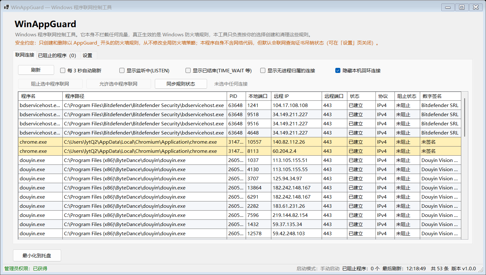
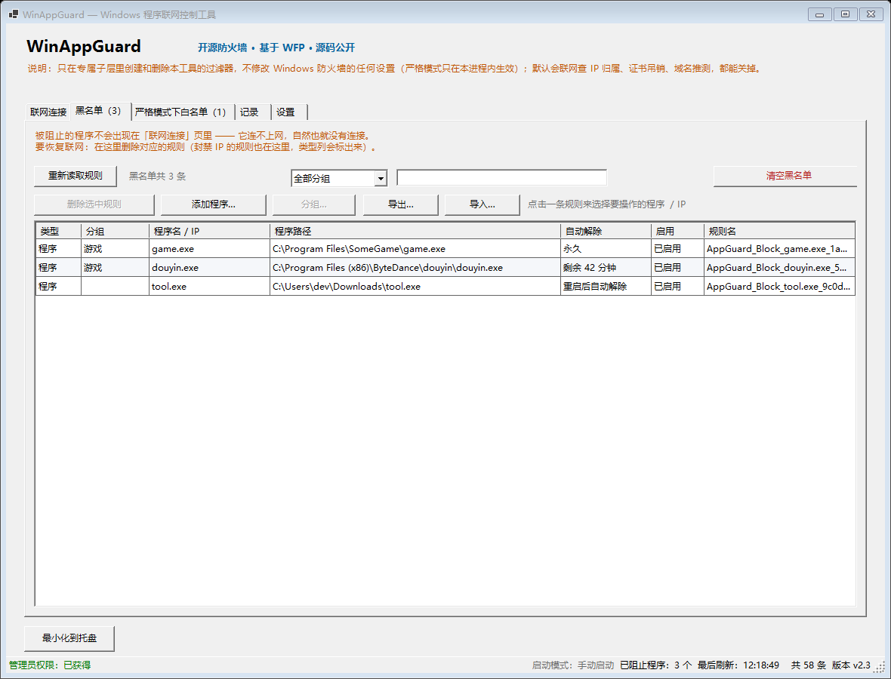
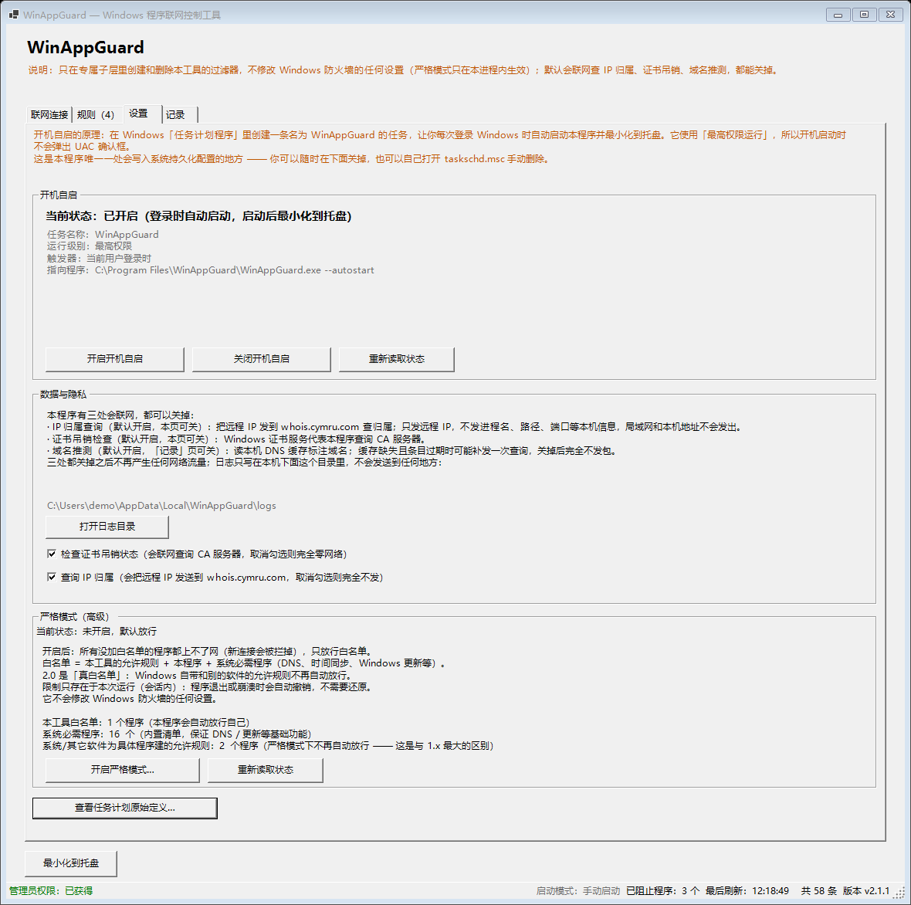
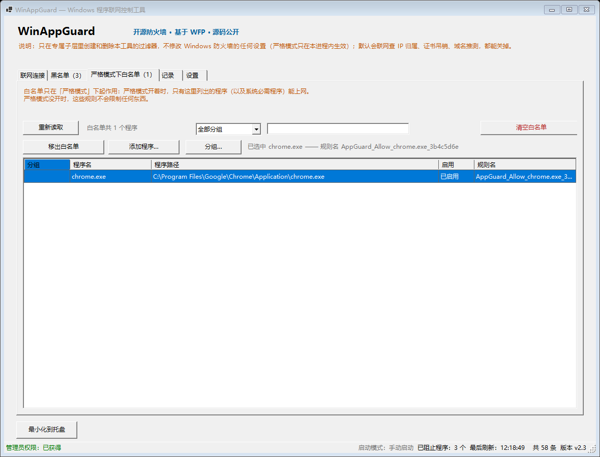
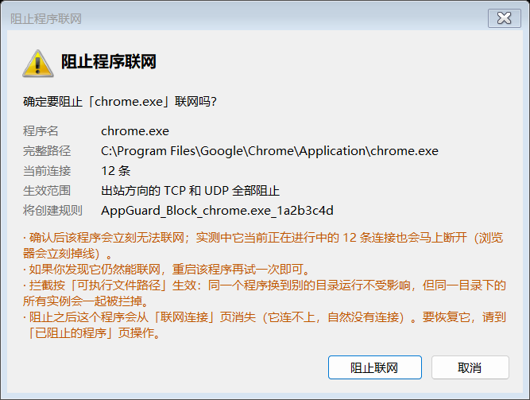

# WinAppGuard

**看清谁在联网，两次点击把它拦掉。**

**开源防火墙** · 基于 WFP 的程序联网控制 · **源码公开，可自行审计与构建**

简体中文 · [English](README.en.md)

> 源码与许可证：[github.com/lovercyh/winappguard](https://github.com/lovercyh/winappguard)（MIT）

WinAppGuard 是一个 Windows 程序联网控制工具，但它和多数同类工具的入手方向相反：
它不让你去翻程序列表，而是直接展示**当前正在联网的 TCP 连接** ——
从「现在是哪个程序在联网」出发，到「已阻止」结束。

> WinAppGuard 本身不处理任何流量。真正生效的是基于 WFP 的独立过滤引擎：
> WinAppGuard 只负责按你的选择创建和清理 WFP 过滤器，数据包匹配与拦截由 Windows 内核 WFP 执行。
> 从 2.0 起它不再使用 Windows 防火墙，也不再修改 Windows 防火墙的任何设置。

[](LICENSE)
[](#环境要求)



---

## 它做什么

- **列出正在联网的 TCP 连接**：程序名、完整路径、PID、本地端口、远程 IP、远程端口、状态、协议（IPv4/IPv6）、**以及该程序的数字签名**
- **告诉你这个连接在跟谁通信**：鼠标停在远程 IP 上，就能看到它的国家/地区和运营商（自治系统）
- **搜索与排序**：按 进程名 / PID / 远程 IP / 远程端口 过滤；点表头排序（端口和 IP 按**数值**排，不是按字符串）
- **阻止某个程序联网**：为该可执行文件写一条出站过滤器（TCP、UDP、IPv4 与 IPv6 一起管），
  并且可以选择**阻止多久** —— 永久 / 30 分钟 / 2 小时 / 直到下次重启；
  限时阻断到期后会**自己解除**
- **允许它重新联网**：删掉自己为它创建的过滤器
- **严格模式（默认关闭，高级功能）**：**真白名单** —— 只有白名单里的程序能上网。
  它在本进程内建立一个动态会话（白名单放行 + 阻止全部），**不改任何系统设置**；
  程序退出、崩溃、被任务管理器强杀，限制都会**自动消失**。
  为保证 DNS / 时间同步 / Windows 更新不被一起挡掉，内置放行一份系统必需程序清单
  （以 `svchost.exe` 为主）。
- **有一页专门管理自己建的规则**，所以程序就算已经不运行了，也随时能恢复
- **「记录」页**：过去一段时间**谁连了谁、有没有被拦** —— 类型（连接·拦截）、程序、远端、
  **域名（推测）**、**命中的是哪条规则**；支持搜索、只看拦截、一键清空。
  记录只写本机、默认开启，**保留期可在记录页选（1 / 3 / 7 / 30 天，默认 7 天）**。
- **封禁 IP**：在「记录」页选中一条连接直接「拦截此 IP」，或手动「添加 IP」。
  规则按**远端 IP** 生效（IPv4 / IPv6），不经过域名解析；同一 IP 上的其它服务会一起被拦。
- **「黑名单」与「严格模式下白名单」分开两页**：黑名单 = 谁不许上网（程序阻止 + 封禁 IP，
  带「类型」列区分）；白名单 = 严格模式下谁可以上网，页面上直接写明"现在生不生效"。
  两页各有搜索，也都可以按路径「添加程序…」（严格模式下没放行的程序不会出现在连接页）。
- **规则分组**：黑名单 / 白名单都有「分组」列和分组筛选；
  分组只影响界面归类，不影响规则是否生效。
- **规则导出 / 导入**：把全部规则（含封禁 IP 与分组）导成一个 JSON 文件，换台机器再导入；
  导入只创建、不删除，坏文件整份拒绝。
- **快捷键**：`F5` 刷新、`Ctrl+F` 搜索、`Esc` 清空、`Delete` 删除选中。
- **记住窗口大小与列宽**（只存尺寸，不存任何隐私数据），下次打开还是原样；
  记录页还能右键复制远端地址 / 程序路径 / 域名。
- **可选开机自启**，启动后直接进系统托盘
- **规则都落在自己专属的 WFP 子层里**，用界面上的两个清单页查看；
  `wf.msc` 里不会出现它们（那里本来就只显示 Windows 防火墙自己的规则）

## 它**不**做什么

这一点必须说清楚，因为它需要管理员权限。

- ❌ **不**过滤、检查或转发任何流量 —— 那全是系统的 WFP 在做
- ❌ **不**修改 Windows 防火墙的任何设置 —— 也不禁用防火墙、不改默认入站/出站动作。
  **严格模式也不例外**：它只在进程内建立会话，退出即撤销
- ❌ **不**碰别人创建的过滤器或规则 —— 只看、只删自己子层 GUID 下的过滤器
- ❌ **不**阻止系统关键进程（`lsass.exe`、`svchost.exe`、它自己……）——
  这道护栏只管「阻止」，不管「允许」（放行永远不会把谁锁在外面）
- ⚠️ 它**默认会联网**，但只有三个明确用途（见下）。**没有遥测、没有统计、没有更新检查**

### 关于「不联网」，说实话

**WinAppGuard 不是零联网程序，文档也不再用含糊的说法掩盖这一点。**
1.1 及更早的版本确实做到了「自身不含任何网络代码」；1.2 加入 IP 归属查询之后，
这个说法**被正式作废**，而不是靠措辞继续维持。

会碰网络的只有**三处**，**都默认开启，也都能在界面上关掉**：

| | 联网由谁发起 | 发什么 | 发给谁 | 怎么关 |
|---|---|---|---|---|
| **IP 归属查询** | 本程序自己的代码 | 只发**远程 IP** | `whois.cymru.com:43` | 设置 → 数据与隐私 |
| **证书吊销检查** | Windows 的证书服务（Crypt32） | CRL / OCSP 查询 | 该证书的 CA | 设置 → 数据与隐私 |
| **域名推测** | 本程序自己的代码 | DNS 查询（**只查系统缓存里已有的名字**） | **本机配置的 DNS 服务器** | **记录** 页的开关 |

三处都关掉之后，本程序**不产生任何网络流量**。

> 关于「域名推测」：它读的是 Windows 的 DNS 缓存；缓存条目刚好过期时，
> Windows 可能向**本机 DNS 服务器**补发一次查询。关掉后程序**不发任何 DNS 查询**，
> 代价是「记录」页的域名覆盖率明显下降（实测 29% → 8%）。

**关于 IP 归属查询**（1.2 新增）：它把每条连接的远程 IP 解析成国家/地区和运营商（自治系统），
让连接列表能回答「我在跟谁通信」，而不只是「是哪个 IP」：

- 只发送**远程 IP** —— 不发进程名、程序路径、PID、端口，或任何其它本机信息；
- 局域网 / 回环 / 链路本地地址**在发送之前就被过滤掉**，根本不出本机；
- 按主机名连接意味着 .NET 运行时会先对 `whois.cymru.com` 做一次 DNS 解析。
  这不是 HTTP 请求，但确实是一次域名解析，所以我们写出来而不是藏着；
- 关掉是**持久生效**的（记在 `settings.json`），重启不会自己打开；
- **第一次运行**会弹一次说明，把上面这些讲清楚。

**关于证书吊销检查**：发起请求的始终是 **Windows 的证书服务**，不是本程序的代码；
过程中不会送出任何关于你或你机器的信息，就是一次标准的 CRL/OCSP 查询。
关掉之后只读本地缓存。

- ❌ **不**用注册表做持久化 —— 开机自启只用任务计划程序，设置只写 `%LOCALAPPDATA%` 下的文件

## 命令行模式

想脚本化 / 批量部署时可以直接用命令行（**需要管理员权限**，包括 `--help`）：

```powershell
WinAppGuard.exe --block "C:\Tools\a.exe"   # 阻止某个程序联网（可重复执行，幂等）
WinAppGuard.exe --list-blocked             # 列出所有「阻止」规则
WinAppGuard.exe --unblock-all              # 只预览要删什么，什么都不删
WinAppGuard.exe --unblock-all --yes        # 真的删掉
WinAppGuard.exe --help                     # 用法
```

- **退出码**：`0` 成功 / `1` 参数错误或未确认 / `2` 执行失败 / `3` 缺少管理员权限。
- `--list-blocked` **一行一条**、制表符分隔，`#` 开头的是说明行 —— 便于脚本解析。
- 这些命令**不弹确认框**（命令行参数本身就是明确指令）；**图形界面里的操作仍然每条都要确认**。
- 图形界面启动时会先出现约 0.5 秒的控制台窗口（控制台子系统换来的同步 CLI），随后自动收起。

## 界面

| 规则 | 设置 |
|---|---|
|  |  |
|  | |



所有会改动系统状态的操作都要先过确认框。确认框里会写明：程序名、**完整路径**、
影响范围、**即将创建或删除的规则名**。

## 下载与使用

从 [最新 Release](https://github.com/lovercyh/winappguard/releases/latest) 下载 `WinAppGuard.exe`。

- 单文件自包含，约 49 MB，**目标机器不需要安装 .NET**
- 可用发布说明里的 SHA-256 校验下载是否被篡改：
  ```powershell
  Get-FileHash .\WinAppGuard.exe -Algorithm SHA256
  ```
- **exe 没有代码签名**，SmartScreen 会提示「未知发布者」，这属于预期情况，见下方常见问题

## 环境要求

- Windows 10 / 11 x64
- 管理员权限（它要管理 WFP 过滤器和任务计划程序）

## 工作原理

| 环节 | 实现 |
|---|---|
| 拦截 | 每个可执行文件路径写**两条**出站过滤器（IPv4 + IPv6），挂在 WFP 的 `ALE_AUTH_CONNECT` 层 |
| 规则命名 | `AppGuard_Block_<程序名>_<路径哈希前 8 位>` —— 确定性命名，重复阻止是幂等的 |
| 访问防火墙 | 直接调用 `fwpuclnt.dll`（WFP 用户态 API），12 个函数、零第三方库 |
| 只碰自己 | 所有枚举/删除都按**子层 GUID** 过滤，别的软件与系统对象一律不碰 |
| 读取连接表 | `iphlpapi.dll` 的 `GetExtendedTcpTable` |
| 反查程序路径 | `QueryFullProcessImageNameW`（不创建 `Process` 对象，所以每 3 秒刷新也不会泄漏句柄） |
| 开机自启 | 一条名为 `WinAppGuard` 的计划任务，登录时触发，最高权限，**不限执行时长** |
| 单实例 | 命名互斥体 + 广播窗口消息，重复启动会把已有窗口叫到前台 |
| IP 归属 | Team Cymru WHOIS，走普通 TCP 连 `whois.cymru.com:43` —— 本程序**主动连接外部主机**的唯一端点；批量查询 + 内存缓存；默认开启，可关闭 |
| 严格模式 | 进程内建立**动态 WFP 会话**：白名单放行（高权重）+ 阻止全部（低权重）。退出/崩溃即自动撤销，不改任何系统设置 |
| 限时阻断 | 到期时间存在**过滤器自己的说明字段**里（`AppGuard\|1\|Block\|路径\|自动解除=…`），重启也不会丢。后台 30 秒定时器负责清理到期规则并弹托盘提示 |

## 可验证的信任

多数工具只能让你「相信它」。这个工具自带验证手段：

```powershell
WinAppGuard.SelfCheck.exe --audit
```

它**不是搜源码**，而是直接读**编译出来的程序集的元数据** —— 包括间接引用和框架自动带进来的东西：

```
引用的程序集            25 个，全部来自 .NET 框架    → 零第三方库
网络相关类型引用        2 个：TcpClient / NetworkStream
                        → 都在预期清单内，只属于 IP 归属查询
原生 API 调用（P/Invoke）  17 个
网络相关原生调用        无                          → 没有绕过托管检查直接用网络 API
注册表访问              无
```

关于这份输出，有两句话要说：

- 从 1.2 起，审计**不再要求「网络类型为零」**，而是要求所有网络类型**全部落在预期清单内**，
  并新增一项检查：不允许有人用 P/Invoke 直接调 `ws2_32` / `winhttp` / `wininet` 绕过去。
  **一份「绿的但藏着联网路径」的审计，比没有审计更糟。**
- `--audit` 不需要管理员权限，所以 CI 里也能跑。

那 17 个原生调用就是程序能碰到的**全部**非托管函数：

```
iphlpapi.dll!GetExtendedTcpTable                    读 TCP 连接表
kernel32.dll!OpenProcess                            打开进程（查路径用）
kernel32.dll!QueryFullProcessImageNameW             查进程可执行文件路径
kernel32.dll!CloseHandle                            关句柄
kernel32.dll!FreeConsole                            图形界面模式启动时收掉控制台窗口
user32.dll!RegisterWindowMessageW                   注册单实例用的自定义消息
user32.dll!PostMessageW                             广播单实例消息
wintrust.dll!WinVerifyTrust                         验证内嵌数字签名
wintrust.dll!CryptCATAdminAcquireContext2           打开目录签名上下文
wintrust.dll!CryptCATAdminCalcHashFromFileHandle2   算文件哈希
wintrust.dll!CryptCATAdminEnumCatalogFromHash       按哈希找所属目录
wintrust.dll!CryptCATCatalogInfoFromContext         取目录文件路径
wintrust.dll!CryptCATAdminReleaseCatalogContext     释放目录上下文
wintrust.dll!CryptCATAdminReleaseContext            释放目录管理上下文
wintrust.dll!WTHelperProvDataFromStateData          从验证状态取数据
wintrust.dll!WTHelperGetProvSignerFromChain         取签名者
wintrust.dll!WTHelperGetProvCertFromChain           取签名者证书
```

**29 个（17 个 Win32 + 12 个 WFP），除此之外它碰不到任何东西。**

## 安全护栏

这些检查做在**规则写入的底层**，不在界面层 —— 界面逻辑写错也绕不过去。

| 护栏 | 位置 |
|---|---|
| 只删除自己子层 GUID 下的过滤器，其余一律看不见、也删不到 | `WfpRuleStore` / `WfpEngine` |
| 创建规则前拒绝系统关键进程 | `FirewallManager.ValidateProgramPath` |
| 拒绝不存在的文件、非 `.exe`、UNC 网络路径 | 同上 |
| 所有危险操作都要弹确认框，删除全部规则要**连续确认两次** | `Forms/ConfirmForm.cs` |

逐条的实现说明和**自查方法**见 [`docs/安全说明.md`](docs/安全说明.md)。

## 从源码构建

需要 [.NET SDK 10](https://dotnet.microsoft.com/download) 或更高。

```powershell
git clone https://github.com/lovercyh/winappguard.git
cd winappguard

dotnet build WinAppGuard.sln -c Debug

# 产出 dist\WinAppGuard.exe（win-x64、自包含、单文件）
powershell -ExecutionPolicy Bypass -File .\build\publish.ps1
```

构建必须 **0 警告 0 错误**。在这个项目里，警告当作缺陷处理，不当噪音。

## 常见问题

### 为什么杀毒软件会报毒？

因为它确实在做这些事：

- 往 WFP 里写过滤器（这需要管理员权限，也需要直接调用系统 API）；
- 创建一条**登录时以最高权限运行**的计划任务 —— 这在技术上就是提权持久化；
- 读取 TCP 连接表并反查进程路径。

启发式引擎对这套组合很敏感。但它创建的东西全部可见、可删：任务名固定为 `WinAppGuard`
且**未勾选隐藏**，过滤器全部在固定 GUID 的专属子层里（一条命令就能清干净）。
想核实二进制文件的能力，跑上面那个 `--audit`。

### SmartScreen 提示「未知发布者」

exe 没有代码签名 —— 代码签名证书要花钱，而这是个免费工具。
点「更多信息」→「仍要运行」，或者先核对发布说明里的 SHA-256。

### 为什么必须管理员权限？

创建防火墙规则和注册计划任务都必须提权。程序在清单里声明了 `requireAdministrator`，
所以启动时会弹 UAC。

### 我点了关闭，但它还在运行

这是刻意设计的。关闭窗口只是收进托盘 —— 如果直接退出，防火墙规则还在生效，
而用户会以为工具已经关掉了，回头找不到恢复入口。
要真正退出，请右键托盘图标选「退出」。

### 退出程序等于放行吗？

**不等于。** 退出只结束界面进程，防火墙规则依然生效，被阻止的程序依然上不了网。
要放行必须用「解除阻止（允许联网）」或「删除全部 AppGuard 规则」。退出时的确认框会明确写这一点。

### 怎么彻底清理干净？

```
1. 打开 WinAppGuard
2. 「黑名单」页 → 清空黑名单（或者跑：WinAppGuard.exe --recover）
3. 「设置」页 → 关闭开机自启
4. 托盘右键 → 退出
5. 删除 WinAppGuard.exe
6. （可选）删除 %LOCALAPPDATA%\WinAppGuard 目录
```

第 2、3 步不做就直接删 exe 的话，过滤器子层和计划任务会留在系统里继续生效。
真遇到这种情况：跑 `WinAppGuard.exe --recover` 清掉 WFP 里的对象，
用 `taskschd.msc` 删任务。

### 阻止是按路径生效的，不是按 PID

规则按程序身份（可执行文件路径）匹配，所以：

- 同一个路径的所有实例会被一起拦掉（不看命令行参数）；
- 同一个程序换到别的目录运行**不受影响**；
- 程序更新后如果安装路径变了，旧规则会失效，重新拦一次即可。

### 为什么被阻止的程序从连接列表里消失了？

因为它连不上网，自然就没有连接可列。请去「规则」页管理它
—— 那一页是基于**你的规则**，不是基于实时流量。

### 日志在哪？

`%LOCALAPPDATA%\WinAppGuard\logs\`，按天分文件，保留最近 7 天。
**只写本机，不会发送到任何地方。** 「设置」页显示这个路径，并提供打开按钮。

## 文档

| 文档 | 内容 |
|---|---|
| [`docs/安全说明.md`](docs/安全说明.md) | 安全模型，九条约定逐条给出自查方法 |
| [`docs/验收清单.md`](docs/验收清单.md) | 全量验收清单（自动化结论 + 手动勾选项） |
| [`docs/测试用例.md`](docs/测试用例.md) | 各阶段测试用例与实测结论 |
| [`docs/发布手册.md`](docs/发布手册.md) | 从构建、验证到发布的操作流程 |

## 参与贡献

见 [`CONTRIBUTING.md`](CONTRIBUTING.md)。简短版：**代码注释和提交信息用中文**，
构建必须零警告，行为改动要配一条能抓住该 bug 的断言。

## 许可证

[MIT](LICENSE)。
