# WinAppGuard

**看清谁在联网，两次点击把它拦掉。**

**开源简易防火墙** · 基于 WFP · **源码公开，可自行审计与构建**

简体中文 · [English](README.en.md)

> 源码与许可证：[github.com/lovercyh/winappguard](https://github.com/lovercyh/winappguard)（GPL-2.0）

WinAppGuard 是一个基于 WFP 的 Windows 防火墙。它不让你翻程序列表，而是直接展示**当前正在联网的 TCP 连接** ——
从「现在是哪个程序在联网」出发，到「已阻止」结束。

> **当前版本 5.10.0**
>
> - 安装/修复后会把安装目录加入系统 PATH，新终端可以直接运行 `WinAppGuard`。
> - 反网络攻击：Suricata 8.0.7 + ET Open，只告警，由你手动选择 WFP 临时阻断；支持规则分类、监听网卡、已读/未读。
> - 连接、反网络攻击、记录三个页面的远端 IP 都支持悬停查看归属信息。
> - 联网连接、记录、DNS、反网络攻击四个页面都能关闭自动刷新；关闭后表格不再定时重建或跳回顶部。
> - 连接页支持「按程序汇总」；五个页面都能导出当前视图（默认 CSV）。
> - 新增「新程序联网提醒」页面（默认关闭）：记录各程序首次联网时间、路径和进程名，可阻止或加入严格模式白名单；可选「新程序默认阻止」，默认关闭。
> - 防护 IDS 和反网络攻击页支持「全部已读」。
> - 设置页可生成诊断包，集中包含连接、DNS、规则、审计、检测事件和日志，方便自己排查或提交 issue。
> - Flow IDS 与防护：端口扫描、局域网 ARP/DHCP、DNS 安全、IPv6 邻接、配置完整性。
> - CLI：只读查询、JSON、规则操作、网络检测、诊断；见 [`docs/5.3-CLI.md`](docs/5.3-CLI.md)。
> - **默认不自动拦截、不新增内核驱动、不自动更新规则、无遥测**；HTTPS 正文不可见；需要 Npcap 1.80+。
>   「新程序默认阻止」是唯一的例外：显式开启后才对本功能新程序建立临时阻止。
>
> 版本历史和完整边界见 [CHANGELOG](CHANGELOG.md)、[`docs/安全说明.md`](docs/安全说明.md)。

[](LICENSE)
[](#环境要求)
[](https://github.com/lovercyh/winappguard/releases/latest)

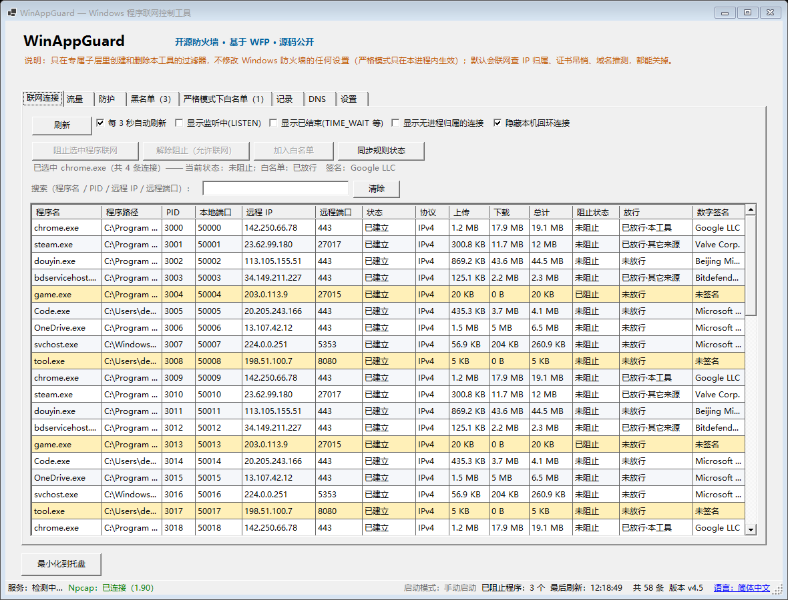

## 它做什么

- **看当前连接**：程序名、完整路径、PID、本地/远端地址端口、状态、协议、数字签名；支持搜索和排序。
- **按程序汇总**：把同一程序的多个连接合并成一行，快速看清连接数、远端数和总流量；仍可直接阻止/允许。
- **导出当前视图**：连接、记录、DNS、反网络攻击、流量页都能导出 CSV 或 JSON，默认 CSV，只包含当前筛选后的结果。
- **新程序联网提醒**：独立页面，默认关闭；记录各程序首次/最近联网时间、路径和进程名，可阻止或加入严格模式白名单；可选「新程序默认阻止」，默认关闭，开启后屏幕中央弹窗询问是否允许联网。
- **IP 归属提示**：连接、反网络攻击、记录页的远端 IP 悬停都能看国家/地区、AS、网段；可在设置里关闭。
- **阻止 / 允许程序**：永久、30 分钟、2 小时或到下次重启；限时阻断会自动解除。
- **严格模式（默认关闭）**：只放行白名单里的程序。它是服务里的会话级限制，退出或服务崩溃即自动撤销，
  不改 Windows 防火墙；另有 30 分钟 / 2 小时临时锁网。
- **流量页**：按程序统计入站/出站/上下行，带 5 分钟实时曲线；Npcap 按包头计数，不读载荷。
- **DNS 页**：记录最近查询的域名、PID、程序和结果；不记录 URL 或响应内容。
- **反网络攻击**：ET Open 规则告警，可按 malware / exploit / DNS / TLS·JA3 / coinminer / phishing / web_client / 其他启用
  （钓鱼默认关闭）；命中后可手动临时阻断。只告警，不自动拦截。
- **Flow IDS 与防护**：周期性外联、端口/主机扫描、内网横向、DNS 异常；端口扫描、ARP/DHCP、DNS 安全、
  IPv6 邻接、名称解析和配置完整性检测。
- **记录与规则**：谁连了谁、有没有被拦、命中的规则；支持封禁 IP、规则分组、导入/导出。
- **诊断包**：设置页一键生成 zip，包含连接、DNS、规则、审计、检测事件和日志，便于自己排查或提交 issue。
- **命令行**：状态、连接、DNS、规则、网络检测、诊断，支持 `--json`；安装后新终端可直接使用。

## 它**不**做什么

- ❌ **不**转发、检查或修改流量，也不做 DPI / HTTPS 解密；数据包匹配和拦截由 Windows 内核 WFP 执行。
- ❌ **不**修改 Windows 防火墙的任何设置，也不碰其他软件的过滤器；只管理自己子层里的对象。
- ❌ **默认不自动拦截**：IDS 和反网络攻击只告警，阻断必须由你手动触发。
  只有显式开启「新程序默认阻止」后，才会对本功能检测到的新程序建立**临时**阻止并弹窗询问。
- ❌ **不**保存数据包或载荷：流量只读 IP/TCP/UDP 头计数，DNS 只记域名，不记 URL。
- ❌ 反端口扫描只读入站 TCP SYN 头；DNS 安全只抓 IPv4 UDP 53；IPv6 邻接默认只告警，NDP 不阻断。
- ❌ **不**阻止系统关键进程（`lsass.exe`、`svchost.exe`、它自己等）。
- ⚠️ 它**默认会联网**，只有三个明确用途；没有遥测、统计或更新检查。见下一节。

## 联网与隐私

会碰网络的只有三处，**都默认开启，也都能在界面上关掉**：

| 用途 | 发什么 | 发给谁 | 怎么关 |
|---|---|---|---|
| IP 归属查询 | 只发远程 IP | `whois.cymru.com:43` | 设置 → 数据与隐私 |
| 证书吊销检查 | CRL / OCSP 查询 | 证书的 CA | 设置 → 数据与隐私 |
| 域名推测 | 只查系统 DNS 缓存里已有的名字 | 本机 DNS 服务器 | 记录页开关 |

三处都关掉后，本程序**不产生任何网络流量**。IP 归属查询不会发送进程名、路径、PID 或端口；
局域网、回环和链路本地地址在发送前就被过滤。第一次运行会弹出说明。

## 命令行

只读查询不需要管理员；写规则、导入、拦截等需要管理员。完整命令见 [`docs/5.3-CLI.md`](docs/5.3-CLI.md)。

```powershell
WinAppGuard --status --json                    # 服务 / 规则 / 检测状态
WinAppGuard --connections --json --limit 50    # 当前 TCP 连接
WinAppGuard --dns --json --limit 50            # 最近 DNS 查询
WinAppGuard --block "C:\Tools\a.exe"           # 永久阻止
WinAppGuard --block "C:\Tools\a.exe" --minutes 30
WinAppGuard --unblock "C:\Tools\a.exe"         # 只解除这个程序
WinAppGuard --network-status --json            # 反网络攻击状态
WinAppGuard --network-alerts --limit 20 --json
WinAppGuard --doctor --json                    # 只读诊断
```

- `--json` 输出固定英文 key，便于脚本解析；退出码：`0` 成功 / `1` 参数错误或未确认 / `2` 失败 / `3` 未提权 / `4` 未找到。
- 批量或不可逆操作要求 `--yes`，可先用 `--dry-run` 预览；GUI 里的操作仍然每条都要确认。
- 5.4 起安装器会自动把安装目录加入系统 PATH；已经打开的终端需要重开。

## 界面

| 反网络攻击 | 防护（端口扫描） |
|---|---|
| 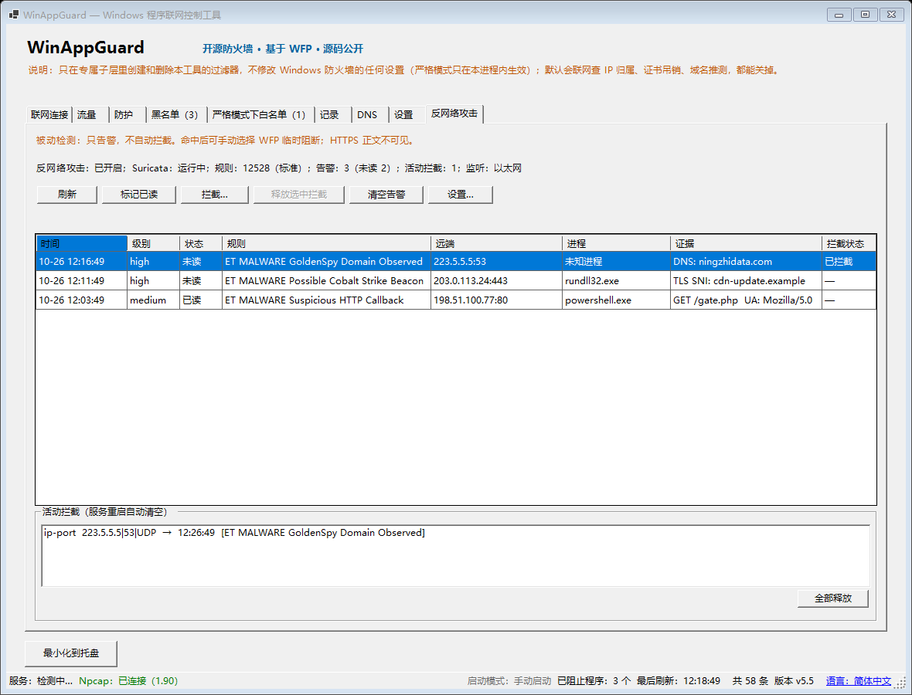 | 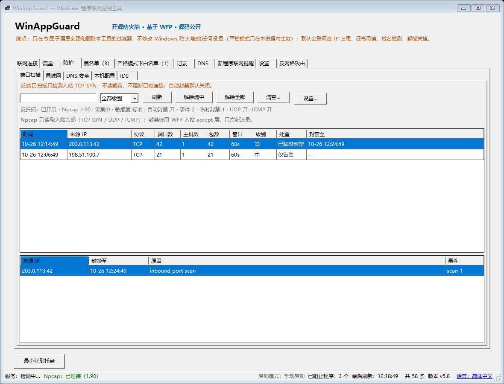 |
| **IDS** | **流量** |
| 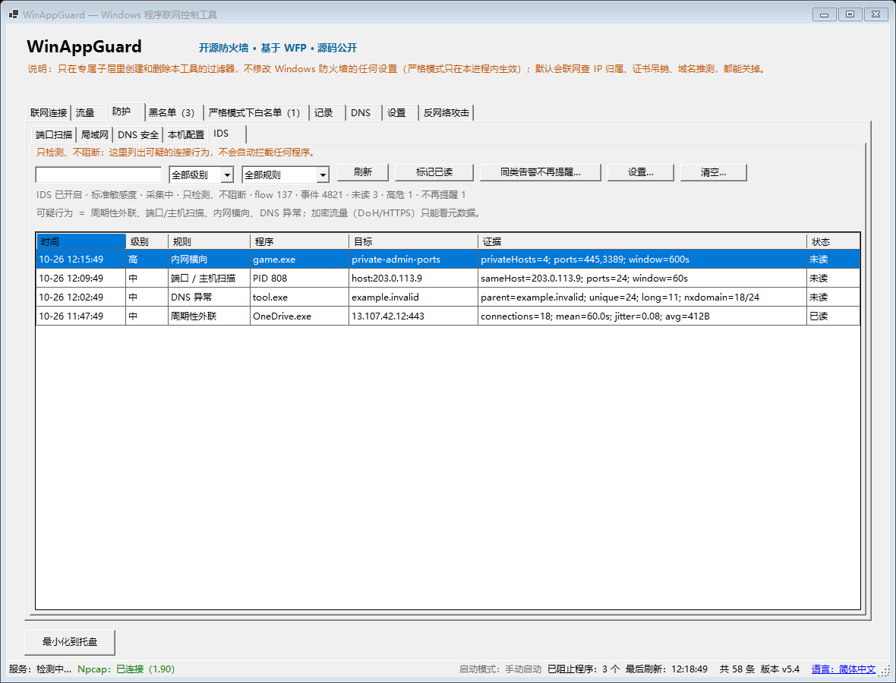 | 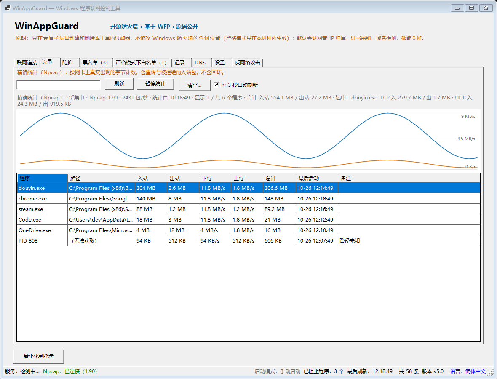 |
| **DNS** | **局域网** |
| 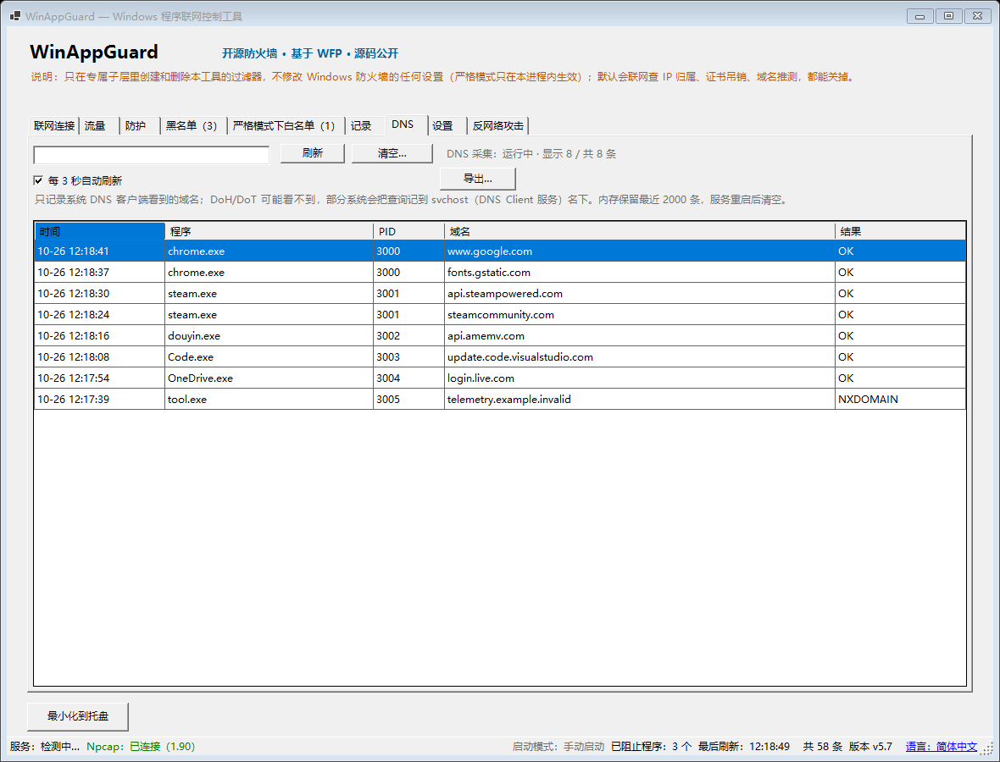 | 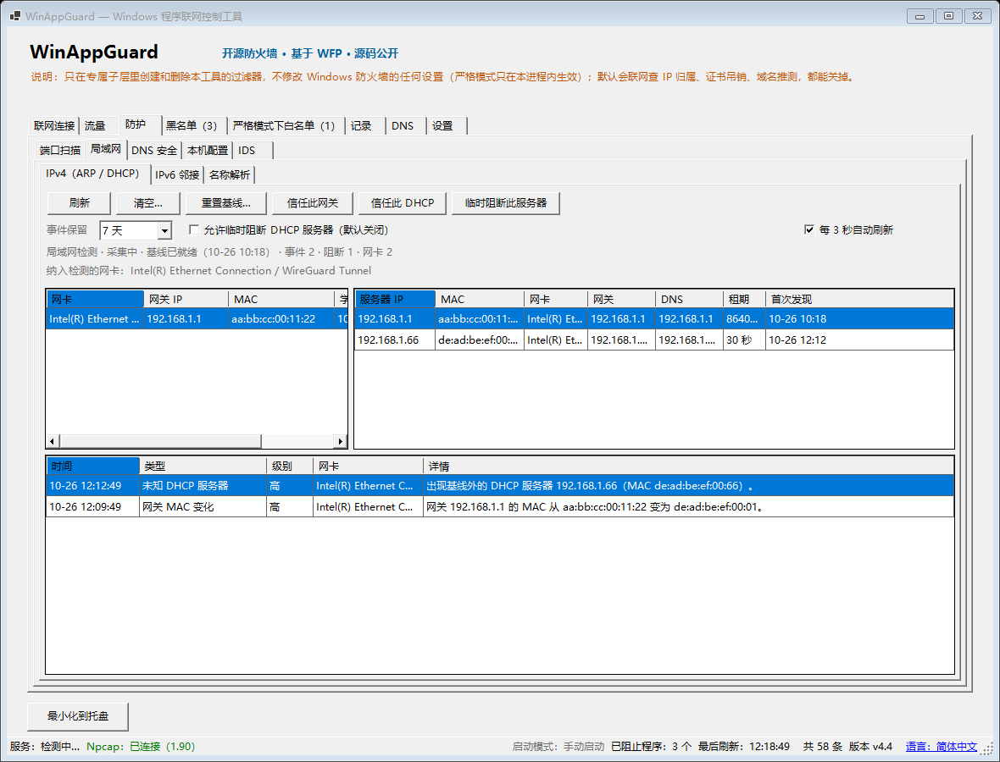 |
| **黑名单** | **严格模式白名单** |
| 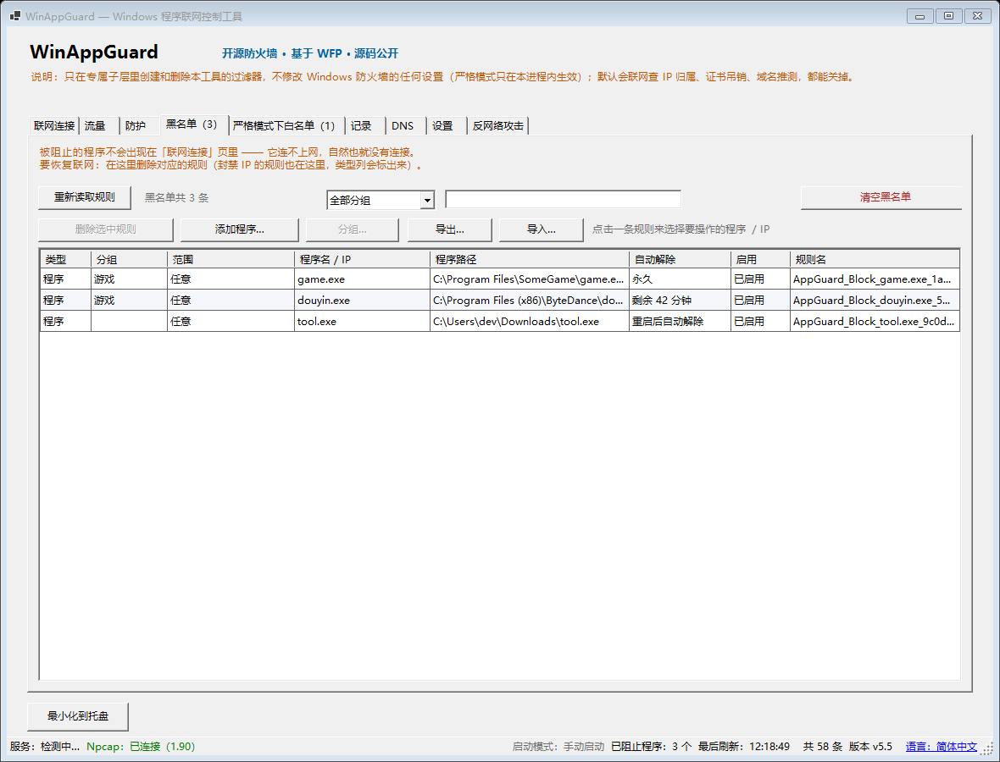 | 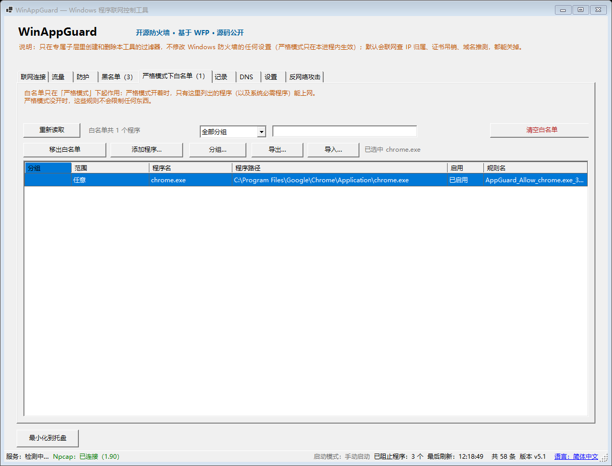 |
| **设置** | **反网络攻击设置** |
| 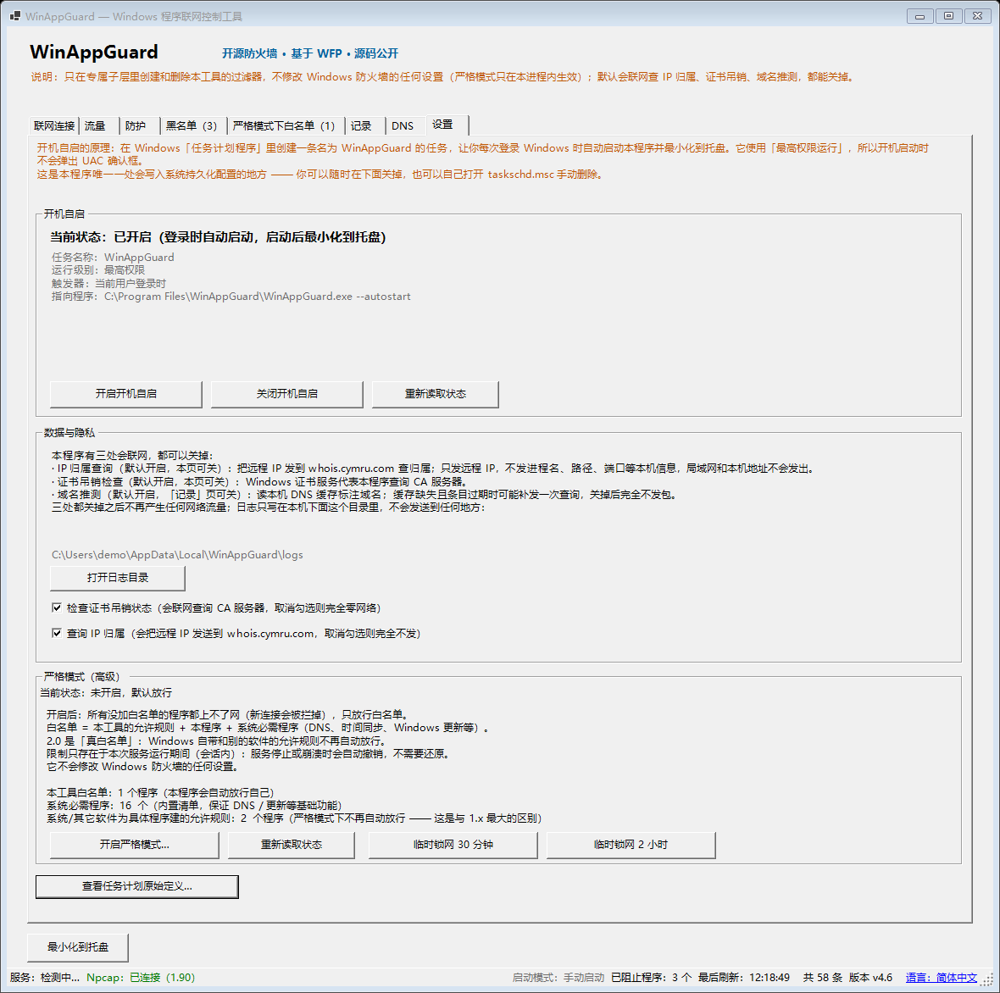 | 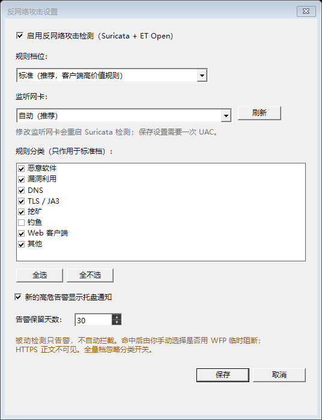 |

所有会改动系统状态的操作都要先过确认框。确认框会写明程序名、完整路径、影响范围和即将创建/删除的规则名。

## 安装 / 卸载

从 [Releases](https://github.com/lovercyh/winappguard/releases) 下载：

| 文件 | 用途 |
|---|---|
| **`WinAppGuardSetup.exe`** | 安装 / 修复（界面和服务已打包在里面） |
| **`WinAppGuardUninstall.exe`** | 完整卸载 |

- 双击 Setup：未安装则安装，已安装则修复；会自动创建桌面快捷方式。
- 双击 Uninstall：删除服务、WFP 规则/子层、快捷方式、自启任务、记录、设置、密钥和安装目录。
- 安装/修复会请求一次管理员权限；界面用普通权限运行，改规则时再弹一次 UAC。
- 安装器不静默安装 Npcap；会先说明原因，再启动官方 GUI。安装目录会保留安装器和许可证文件。
- 安装包没有代码签名，SmartScreen 首次运行会提示「未知发布者」；可用发布说明里的 SHA-256 校验。

## 环境要求

- Windows 10 / 11 x64
- Npcap 1.80+（安装器随包 1.90，通过官方 GUI 安装）
- 安装与 CLI 写操作需要管理员；运行发布包不需要 .NET
- 从源码构建需要 .NET SDK 10

## 实现与安全

| 环节 | 实现 |
|---|---|
| 拦截 | 每个程序路径写 IPv4 + IPv6 两条出站过滤器，挂在 WFP `ALE_AUTH_CONNECT` 层 |
| 只碰自己 | 所有枚举/删除都按自己的子层 GUID 过滤，其他软件和系统对象不碰 |
| 服务 | `WinAppGuardSvc` 以 SYSTEM 运行，是唯一写 WFP 的进程；界面通过签名 IPC 请求 |
| 权限 | 所有者账户使用界面；改规则/严格模式/记录设置时走一次 UAC；WFP 对象只允许 SYSTEM + 所有者删除 |
| 检测 | Npcap 抓 TCP/UDP/ICMP 头和 DNS；ETW 看连接与 DNS；Suricata 读 `eve.json`；全部只读元数据 |
| 自启 | 一条名为 `WinAppGuard` 的计划任务，登录触发，最高权限，不隐藏 |

安全模型、ACL、密钥生命周期和逐条自查方法见 [`docs/安全说明.md`](docs/安全说明.md)。

## 常见问题

**杀毒软件报毒？** 它会写 WFP 过滤器、创建最高权限的计划任务、读取 TCP 连接表，启发式引擎容易误判。
创建的对象都可见、可删：任务名固定，过滤器在专属子层里。

**SmartScreen 提示未知发布者？** 因为 exe 没有代码签名。点「更多信息 → 仍要运行」，或先核对 SHA-256。

**提示“当前账户不是所有者 / 密钥不可用”？** 只有安装时的所有者能使用界面和服务。换所有者用
`WinAppGuardSetup.exe --reset-owner`；密钥损坏用 `--rotate-key`；未初始化用 `--repair`。

**点了关闭但程序还在？** 关闭窗口只是收进托盘。要真正退出，右键托盘图标选「退出」；退出不会解除防火墙规则。

**退出等于放行吗？** 不等于。退出只结束界面，规则仍然生效；要放行请用「解除阻止」或「删除全部 AppGuard 规则」。

**阻止按 PID 吗？** 不按。规则按可执行文件路径匹配；同一路径的所有实例一起拦，换目录运行不受影响。

**日志在哪？** 界面日志 `%LOCALAPPDATA%\WinAppGuard\logs\`（默认 7 天）；服务日志
`%ProgramData%\WinAppGuard\logs\`（固定英文 + 事件码）。都只写本机。

**怎么彻底清理？** 运行 `WinAppGuardUninstall.exe`。想保留规则/记录可加 `--keep-data`（密钥仍会删除）；
只想清 WFP 对象可在管理员终端运行 `WinAppGuard --recover`。

## 文档

| 文档 | 内容 |
|---|---|
| [`docs/安全说明.md`](docs/安全说明.md) | 安全模型、权限、ACL、密钥和自查方法 |
| [`docs/验收清单.md`](docs/验收清单.md) | 全量验收清单 |
| [`docs/发布手册.md`](docs/发布手册.md) | 构建、验证、发布流程 |
| [`docs/5.3-CLI.md`](docs/5.3-CLI.md) | CLI 命令、权限、JSON、退出码 |
| [`docs/5.4-安装PATH.md`](docs/5.4-安装PATH.md) | 安装器写 PATH 的行为与验收 |
| [`docs/5.7-数据出口与连接汇总.md`](docs/5.7-数据出口与连接汇总.md) | 连接汇总、表格导出、诊断包 |
| [`docs/5.8-新程序联网提醒.md`](docs/5.8-新程序联网提醒.md) | 新程序首次联网记录、提醒与全部已读 |
| [`docs/5.9-架构统一.md`](docs/5.9-架构统一.md) | 5.9 架构统一阶段、兼容性约束与测试边界 |
| [`docs/测试用例.md`](docs/测试用例.md) | 各阶段测试用例与实测结论 |

更多设计文档见 [`docs/`](docs/)。

## 从源码构建

需要 [.NET SDK 10](https://dotnet.microsoft.com/download) 或更高。

```powershell
git clone https://github.com/lovercyh/winappguard.git
cd winappguard
dotnet build WinAppGuard.sln -c Debug
powershell -ExecutionPolicy Bypass -File .\build\publish.ps1
```

构建必须 **0 警告 0 错误**。

## 参与贡献

见 [`CONTRIBUTING.md`](CONTRIBUTING.md)。简短版：代码注释和提交信息用中文，构建必须零警告，
行为改动要配一条能抓住该 bug 的断言。

## 许可证

[GPL-2.0](LICENSE)。
